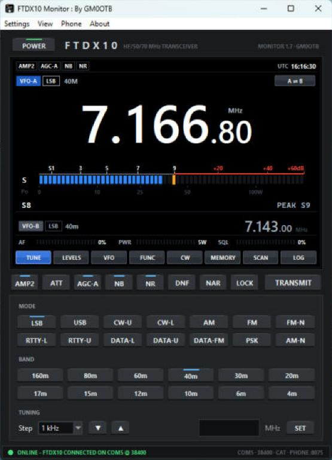
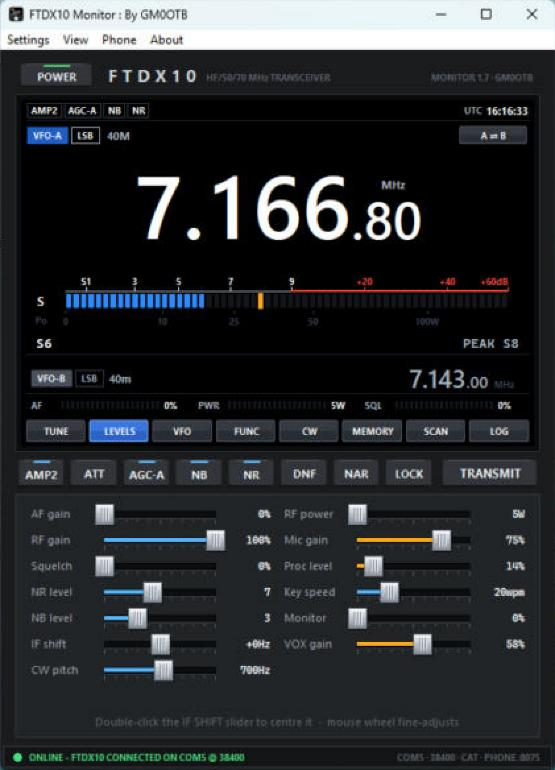

# FTDX10 Monitor

**A Windows control panel for the Yaesu FTDX10, with remote operation from your phone.** By GM0OTB.

FTDX10 Monitor talks to the radio over its USB cable (CAT), shows a large display with meters and every everyday control, and serves a password-protected web page so you can listen, talk and tune from a phone anywhere, over Tailscale. It has the same look and layout as IC9700 Monitor (by the same author), without the spectrum scope, and both programs can run at the same time.


## What's in this repository

| Part | What it is | Docs |
| --- | --- | --- |
| **FTDX10 Monitor** (`FTDX10_Monitor.py`) | The Windows program: display, meters, all controls, memories, scanner, QSO log | [Desktop app](docs/desktop-app.md) |
| **Phone page** | Remote control in the phone's browser: display, meter, tuning, modes, bands, levels, functions, memories, audio both ways | [Phone page](docs/phone-page.md) |
| **Windows installer / portable exe** | Builds a setup `.exe`, or a single portable `.exe`, so it runs without Python | [Windows builds](docs/windows-installer.md) |

Also: [Troubleshooting](docs/troubleshooting.md) · [CAT commands used](docs/cat-reference.md) · [Changelog](CHANGELOG.md)

## Features

- **Large VFO-A readout** that fills the window; the mouse wheel over a digit tunes that digit; ▲/▼ = step, PgUp/PgDn = 1 MHz.
- **Yaesu-style S-meter** with peak hold, blue up to S9 and red above; TX view shows Po (watts), SWR, ALC, COMP and Id.
- **VFO-B** readout (double-click to swap A/B), A=B, B=A, split, TX VFO select.
- **POWER key** switches the radio on and off over CAT, from the PC or the phone.
- **Quick keys:** IPO / AMP1 / AMP2, ATT 6 / 12 / 18 dB, AGC F / M / S / AUTO, NB, NR, DNF, NAR, LOCK and TRANSMIT.
- **All modes** (LSB, USB, CW-U/L, AM, AM-N, FM, FM-N, RTTY-L/U, DATA-L/U/FM, PSK) and **12 band keys**, 160 m to 4 m.
- **13 levels:** AF, RF, SQL, NR, NB, IF shift, CW pitch, RF power, mic, processor, key speed, monitor, VOX gain.
- **PROC, VOX, MON, BK-IN, keyer, RIT/XIT** with clarifier offset, FM repeater shift and CTCSS TONE / TSQL.
- **CW:** free text and 6 macros sent through the rig's keyer memory 5, plus playback of keyer memories 1-4.
- **Memories:** read 001-099 from the radio, recall to VFO or select on the rig, CSV import / export; scanner with a band-activity plot.
- **QSO log** with dupe check, ADIF and CSV export.
- **Phone access** over Tailscale with HTTPS: hear the radio, hold TALK to transmit, tune and change settings.

<p>



</p>

*The Windows program on a live FTDX10: TUNE, LEVELS and FUNC tabs.*

<p>


</p>

*The phone page: tuning, functions and levels. Images show sample radio data.*

## Quick start

1. **Radio:** MENU > OPERATION SETTING > GENERAL > **CAT RATE** 38400.
2. **PC:** install Python 3 from [python.org](https://www.python.org/downloads/), then in a command prompt:
   ```
   py -m pip install pyserial sounddevice
   ```
3. Plug in the USB cable and run `FTDX10_Monitor.py`.
4. **Settings > Settings…**: choose the radio's **Enhanced COM Port** (the FTDX10 shows two; CAT is on the "Enhanced" one) or Auto-detect, and the same CAT rate as the radio, then **Save & connect**.

To run it like a normal Windows program instead, see [Windows builds](docs/windows-installer.md).

## Requirements

| | Needed |
| --- | --- |
| Radio | Yaesu FTDX10, USB cable (Yaesu virtual COM port driver) |
| PC | Windows 10 or 11 with Python 3.10 or later, or a built `.exe` |
| Python packages | `pyserial`; `sounddevice` only for phone audio |
| Phone access | [Tailscale](https://tailscale.com/) on the PC and phone |

## Files the program keeps

Settings, the QSO log and the HTTPS certificate (`ftdx10_settings.json`, `ftdx10_qso_log.json`, `ftdx10_https.crt` / `.key`) are saved next to the program, or in `%LOCALAPPDATA%\FTDX10 Monitor` for the installed program. They are personal and listed in `.gitignore`, so they never go into this repository.

## Licence

No licence has been chosen yet, so the usual copyright rules apply: you may look at and download the code, but not reuse or redistribute it without permission from the author.
