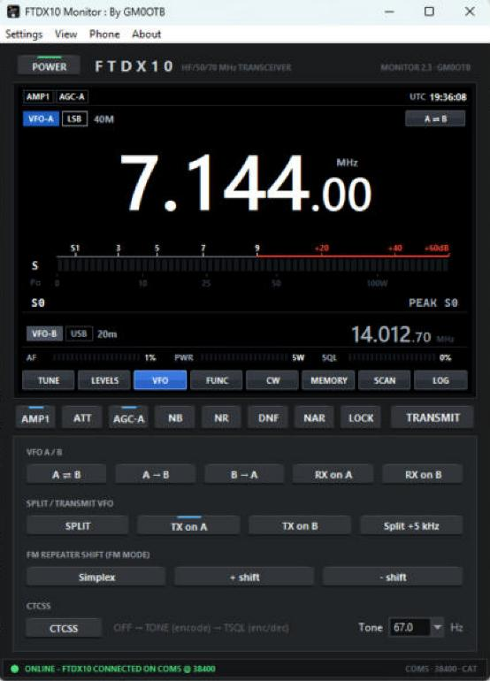
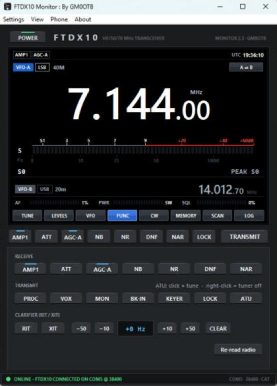

# Desktop app

FTDX10 Monitor controls the FTDX10 over the USB cable using Yaesu CAT. Changes made on the radio's front panel show up in the program too, because it re-reads the radio continuously.

## Setting up

**Radio:** MENU > OPERATION SETTING > GENERAL > **CAT RATE**: 38400 recommended.

The FTDX10's USB connection shows two COM ports in Windows. CAT is on the **Enhanced COM Port**; the Standard one is for PTT/keying lines.

**First connection:**

1. Plug in the USB cable and start the program.
2. Open **Settings > Settings…**.
3. Choose the **COM port (Enhanced)** or **Auto-detect**, the same baud rate as the radio's CAT RATE (4800, 9600, 19200 or 38400), your callsign and a PTT time-out.
4. Click **Save & connect**. The status bar turns green and says "ONLINE".

## The window

| Part | What it shows or does |
| --- | --- |
| **POWER** (top left) | Switches the radio on and off over CAT. Green = on. Switching off asks first. Switching on works while the radio is off, as long as USB and DC power are connected. |
| Frequency | VFO-A. Mouse wheel over a digit tunes that digit; ▲/▼ keys tune by the step; PgUp/PgDn = 1 MHz |
| Tags | Mode, band, VFO / MEM / M.TUNE / QMB / PMS, +RPT / −RPT |
| S-meter | Yaesu-style, with peak hold |
| TX meter | Po (watts), SWR, ALC, COMP and Id |
| VFO-B | Second readout; double-click to swap A and B |
| Status bar | Connection and messages; port, baud and phone port |

## Quick keys

| Key | Action |
| --- | --- |
| IPO / AMP1 / AMP2 | Front-end preamp (click to cycle) |
| ATT | Off / 6 / 12 / 18 dB (click to cycle) |
| AGC | F / M / S / AUTO (click to cycle) |
| NB / NR / DNF / NAR | Noise blanker, noise reduction, digital notch, narrow filter |
| LOCK | Dial lock |
| TRANSMIT | PTT on/off. Released after the PTT time-out, on disconnect and on exit. |

## Tabs

| Tab | Contents |
| --- | --- |
| TUNE | Modes (LSB, USB, CW-U/L, AM, AM-N, FM, FM-N, RTTY-L/U, DATA-L/U/FM, PSK), tuning step, band keys 160 m - 4 m (each returns to the last frequency used) |
| LEVELS | AF, RF, SQL, NR, NB, IF shift, CW pitch, RF power, mic, processor, key speed, monitor, VOX gain |
| VFO | VFO A / B: A → B, B → A, A ⇄ B, receive on A or B, transmit on A or B, split +5 kHz; FM repeater shift (simplex / + / −); CTCSS OFF → TONE → TSQL with tone selection |
| FUNC | Receive and transmit functions (PROC, VOX, MON, BK-IN, keyer and the quick-key functions); **ATU** (starts the radio's tuning cycle; right-click to switch the tuner off); clarifier RIT / XIT with offset and clear |
| CW | Free text and 6 macros sent through the rig's keyer memory 5; play the rig's keyer memories 1-4; {MYCALL} and {CALL} substitution; **CW DECODER** opens the decoder window |
| MEMORY | Read memories 001-099 from the radio (frequency, mode, shift, CTCSS, tag name); recall to VFO or select on the rig; save, overwrite, delete; CSV import / export |
| SCAN | Scan memories or a range, stopping on squelch and/or S-meter, with a band-activity plot (click a bar to tune there) |
| LOG | QSO log with dupe check; ADIF and CSV export |

## Antenna tuner

On the **FUNC** tab:

- Click **ATU** to tune: it starts the FTDX10's tuning cycle, like holding the radio's TUNE key, and switches the tuner on. The radio transmits a carrier while it tunes; the key shows **TUNING** until it has finished. The status bar then says **ATU TUNED**, or that it could not tune (check the antenna, the band and the RF power).
- The key stays lit, and "ATU" shows on the display, while the tuner is on.
- **Right-click ATU** to switch the tuner off.

On the phone's FUNC tab, tap **ATU** to tune and long-press it to switch the tuner off.

## CW decoder

Click **CW DECODER** on the CW tab (or **View > CW decoder…**). A separate window opens and starts decoding the radio's receive audio:

| Part | What it does |
| --- | --- |
| **ON / OFF** | Starts and stops decoding. Closing the window also stops it. |
| Light and bar | The light turns green while a tone is keyed; the bar shows its strength. |
| Tone / WPM | The tone being decoded and the measured speed. |
| **Tone** list | **Auto** finds the strongest keyed tone between 300 and 1200 Hz. **Rig pitch** listens only at the radio's CW pitch (LEVELS tab), which is best in CW mode with a busy band. |
| **Sensitivity** list | **Auto** (recommended): as sensitive as Max, matched to the sending speed, and backs off by itself while it sees static. **Low**: strong signals only. **Normal**: clean signals. **High**: weak signals. **Max**: the weakest signals, with more mistakes from noise. |
| **CLEAR** | Clears the text. |

Tips:
- It needs the radio's USB audio, the same as the phone: `py -m pip install sounddevice` (the installed program already has it), and on the radio **USB AF/IF Output = AF**.
- For a weak signal try **Max**; if noise turns into stray letters, step down to High or Normal.
- A narrow filter (NAR) and a steady signal give the best copy. Very weak, fading or badly sent signals will show some `*` or wrong letters.
- If the rig's squelch is closed, the decoder hears nothing: turn SQL down.
- Speed and tone settle within the first few characters, so the first letter of an over may be wrong.

## Logging QSOs

1. Type the **Call**; a call already in the log is flagged as a dupe.
2. Change RST if needed, add name, grid and notes.
3. Click **LOG QSO**. UTC time, frequency and mode come from the radio.
4. **Export ADIF** for logbook programs or LoTW; **Export CSV** for spreadsheets.

## Menus

| Menu | Items |
| --- | --- |
| Settings | Settings… · Phone access… · Reconnect · Disconnect · Re-read radio state |
| View | Always on top |
| Phone | Phone access, audio (RX / TX) & HTTPS… · Turn on HTTPS · Open the phone page on this PC |
| About | Version and author |

## Where files are kept

| Running | Settings, QSO log, HTTPS certificate |
| --- | --- |
| `FTDX10_Monitor.py` or the portable `.exe` | The same folder as the program |
| Installed program | `%LOCALAPPDATA%\FTDX10 Monitor` |
