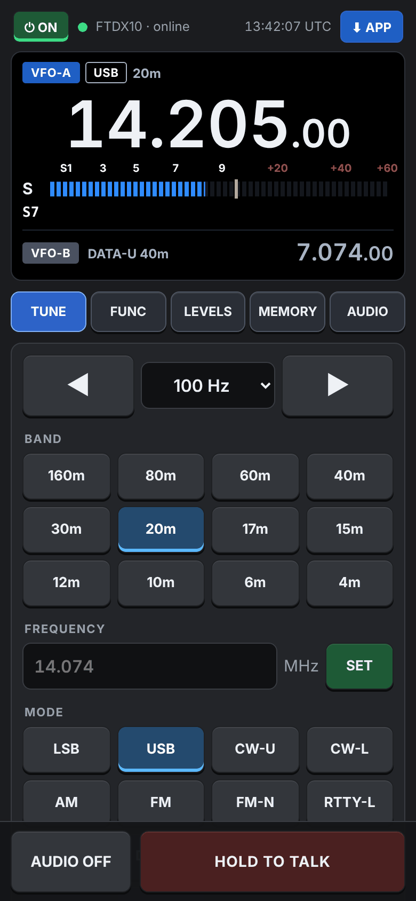
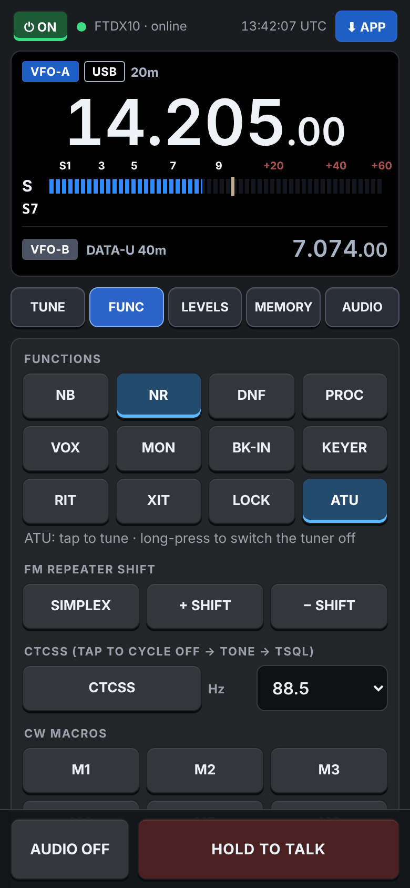
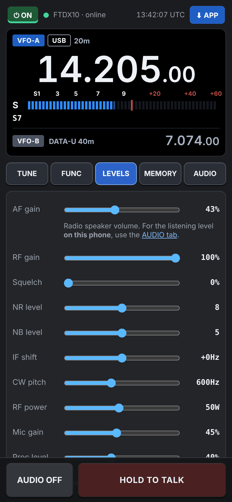
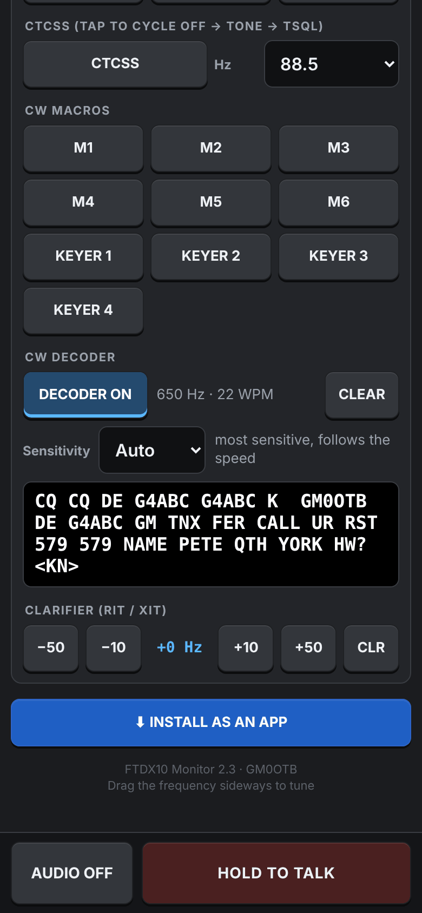

# Phone page

FTDX10 Monitor has a built-in, password-protected web page for your phone: display, meter, tuning, modes, bands, levels, functions and memories, with radio audio on the phone and TALK to transmit. It uses its own ports (**8075** and **8076**) and sign-in, so it runs alongside IC9700 Monitor.

## Setting up (once)

1. Install [Tailscale](https://tailscale.com/) on the PC and phone and sign both in to the same account.
2. On the PC: **Phone > Phone access, audio (RX / TX) & HTTPS…**
   - Tick **Allow access from my phone / browser** and choose a **password** (6 characters or more).
   - Choose the FTDX10's USB audio for **Receive audio from** and **Transmit audio to**, or leave on Auto.
   - **Save**.
3. Click **Turn on HTTPS**. This gets a certificate for the PC from Tailscale and starts the secure page at an address like `https://your-pc.tailnet-name.ts.net:8076/`. Use this address: phones only allow the microphone on https pages.
4. **Radio**, for transmit audio from the phone: set the mode's **MOD SOURCE** to **REAR** and **REAR SELECT** to **USB** in the FTDX10 menu. Set them back to MIC for the hand microphone.
5. Open the https address on the phone and sign in. The phone stays signed in.

Audio needs one Python package on the PC: `py -m pip install sounddevice`. The built `.exe` already includes it.

## What's on the page

| Tab | Contents |
| --- | --- |
| (top) | Power ⏻ ON / OFF (off asks first), connection, frequency, S / Po meter |
| TUNE | Band, frequency and step, mode, VFO A / B |
| FUNC | Functions (IPO/AMP, ATT, AGC, NB, NR, DNF, NAR and more); ATU (tap to tune, long-press for tuner off); FM repeater shift; CTCSS (tap to cycle OFF → TONE → TSQL); CW macros; CW decoder (ON / OFF, sensitivity, decoded text, CLEAR); clarifier RIT / XIT |
| LEVELS | Level sliders. AF is the radio's own speaker volume; the listening level on the phone is set on the AUDIO tab. |
| MEMORY | Memory channels: tap to recall |
| AUDIO | Audio on/off, volume, mic gain, TX tone, hold or tap mode, squelch muting; install as an app |

**TALK** keys the radio and sends your voice. Hold to talk, or switch to tap-on/tap-off on the AUDIO tab.

## Safety

- PTT drops if the phone's microphone audio stops or the connection is lost.
- The PC's PTT time-out also applies.
- Switching the radio off from the phone asks for confirmation. Remote power needs the PC on with FTDX10 Monitor running, the USB cable connected and the radio's DC supply on.
- Commands are only accepted from the page itself, after sign-in.

## Install as an app

On the https page, Chrome on Android offers **⋮ > Install app**, and iPhone Safari offers Share > **Add to Home Screen**. The page also has an **INSTALL AS AN APP** button with the steps for your phone.
